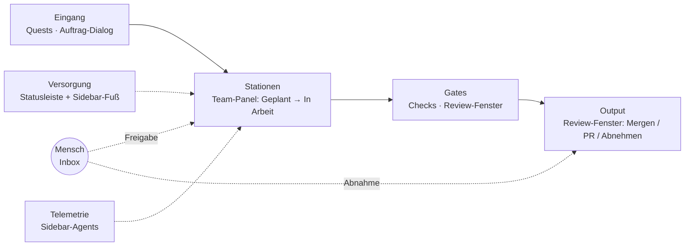

# UI-Spec Herdr · Layout `elric`

Verbindliche Vorgabe für den UI-Umbau („Alles optisch anpassen, damit die aktuellen Funktionen
konsistenter ineinandergreifen und der Platz besser genutzt wird“). Drei Agents setzen sie parallel
in den Paketen A, B und C um (Abschnitt 8). Was hier nicht steht, bleibt wie es ist.

Inhalt: 1 Testverfahren · 2 Audit · 3 Fabrik-Modell · 4 Informationsarchitektur · 5 Tokens und
Bausteine · 6 Layout `elric.json` · 7 Verträge zwischen den Paketen · 8 Pakete A/B/C ·
9 Datei-Eigentum und Merge · 10 Prüfbefehle

---

## 1. Testverfahren

Jeder Worktree bekommt ein eigenes Vorschau-Fenster mit eigenem Herdr-Home **und eigenem
herdr-core**. Die Live-Config `~/.config/herdr-app`, das Fenster des Menschen und seine Spaces,
Tabs und Terminals bleiben unberührt.

```sh
docs/ui-preview.sh up            # Test-Home bauen, Test-Core + Fenster starten, Demo-Welt anlegen
docs/ui-preview.sh sync          # nach jeder Änderung: Worktree → Test-Home (Mods laden live neu)
docs/ui-preview.sh check <mod>   # herdr-app check im Test-Home
docs/ui-preview.sh shot <name>   # Screenshot → /tmp/ui-audit/<name>.png (SHOTS=… ändert den Ordner)
docs/ui-preview.sh do <cmd> …    # herdr-app do im Test-Fenster, z. B.:
docs/ui-preview.sh do layout.show --id panel
docs/ui-preview.sh do layout.select --stack panel-body --child team
docs/ui-preview.sh do mod.open --name inbox          # erneut: schließt es wieder
docs/ui-preview.sh do layout.resize --id sidebar --px 76   # Rail
docs/ui-preview.sh hc ls          # hc gegen den Test-Core
docs/ui-preview.sh hub status    # bin/hub gegen Test-Home und Test-Core
docs/ui-preview.sh down          # Fenster und Test-Cores beenden (Test-Home bleibt liegen)
```

Wie es isoliert:

| Mechanik | Wirkung |
|---|---|
| `HERDR_APP_HOME=~/.herdr/ui-preview/<worktree>` | Test-Home: Kopie der Live-Config ohne `.git`, Tickets, Klick-Zustand und Orchestra-Daten; darüber alle getrackten und neuen Dateien des Worktrees. Herdr schreibt `shared.json`, `view.json`, `.state` nur dort. |
| `HC_SESSION=uiprev-<hash>` | Eigener herdr-core. Die Terminals des Menschen erscheinen im Test-Fenster nicht und werden nie umgebrochen; Befehle im Test-Fenster treffen nur Test-Terminals. `demo-vm` ist ein zweiter lokaler Test-Core (`hc machine add --via "sh -c" --session …-vm`), er zeigt die Maschinen-Gruppierung. |
| `open -n -g -a Herdr.app --env …` | Eigene App-Instanz im Hintergrund, kein Fokuswechsel, überlebt die aufrufende Shell. `HERDR_RELEASES_URL` zeigt ins Leere (keine Update-Downloads), `HERDR_TELEMETRY=0`. |
| `window.json`: y = 1070 (`UI_PREVIEW_Y`) | macOS zeichnet ganz verdeckte Fenster nicht neu; `shot` liefert dann ein altes Bild. Das Test-Fenster liegt deshalb bis auf einen ~37 px hohen Streifen unterhalb des Bildschirms; dieser Streifen ist sichtbar (unter dem Fenster des Menschen), also zeichnet macOS das Fenster, und zwar in voller Größe (Screenshot 3420×2020). |
| `demo/agent.sh` + `programs.json` | Agents sind Shell-Skripte, die per OSC 7501 `working`, `blocked`, `done` oder `idle` melden. `claude`, `pi`, `hermes` und `omp` starten im Test-Home nur dieses Skript: Launcher, Quests und Orchestrator-Neustart starten nie einen echten Agent. |
| Demo-Daten | 4 Tickets (review, doing, todo, done) auf einem Demo-Repo `demo/repo` mit zwei Worktrees, ein Team, Kosten, ein Fake-Orchestrator. Mergen und PR im Test-Fenster treffen nur das Demo-Repo. Quests-Writeback steht auf dry run. |
| Layout-Patch im Test-Home | Der Block `orchestra-daemon` wird entfernt (er würde Agents starten und Budgets durchsetzen). Töne aus. |

Nachweis (dieses Ticket): Worktree-Fenster gestartet, alle Flächen fotografiert
(`/tmp/ui-audit/01-overview.png` … `31-layout-quests.png`), eine Wegwerf-Änderung an
`mods/tabs-graph/main.js` per `sync` live sichtbar gemacht (`/tmp/ui-audit/90-hotreload-proof.png`,
Knopf „HOTRELOAD“) und zurückgenommen. Vorher/nachher geprüft: `herdr-app ls` und `hc ls` der echten
Welt unverändert, `~/.config/herdr-app` ohne Änderungen, nach `down` keine Test-Prozesse mehr.

Regeln im Test-Fenster:

- **Nie** „herdr-core … is ready → Open Updates“ oder ein Update anklicken: das Core-Update gilt für
  die ganze Maschine, also auch für den Menschen.
- **Nie** `HC_SESSION`/`HERDR_APP_HOME` in die eigene Shell exportieren. Spätere `herdr-app`/`hc`-Aufrufe
  träfen still das falsche Fenster. Immer über `docs/ui-preview.sh …` gehen.
- Orchestrator-Karte: „Neu starten“ und „Starten“ kopieren `mods/orchestra/orchestrator.md` nach
  `~/.herdr/orchestrator/` (dem echten Arbeitsordner). Nur klicken, wenn die Datei im Worktree unverändert ist.
- **Space-Ordner** (`space-folders`: Ordner anlegen, umbenennen, färben, Spaces hineinziehen) schreiben
  `~/.config/herdr-space-folders.json`, fest verdrahtet und **dieselbe Datei wie im echten Fenster**
  (`space-folders/main.js:23,104-108`). Heute gibt es sie nicht. Wer Ordner im Test braucht: danach
  `rm ~/.config/herdr-space-folders.json` (bzw. vorher sichern und zurücklegen). Von selbst schreibt der
  Mod nichts. Weitere Wege nach außen in eigenen Mods: Filetree liest `~/.local/state/herdr-filetree`,
  Blueprint liest `~/.claude/settings.json` und speichert PNGs auf Knopfdruck in `~/Downloads`,
  Marketplaces/MCP schreiben Agent-Konfigurationen nur auf Knopfdruck (Hinzufügen/Entfernen: im Test
  nicht klicken). Geprüft per grep auf `writeFile`, `writeTextFile`, `exec("sh"`, `home()`.
- `bin/hub` nimmt ohne `HERDR_APP_HOME` die Live-Config. Von Hand nur über `docs/ui-preview.sh hub …`;
  aus dem Test-Fenster heraus (Knöpfe Mergen/PR) erbt es die Umgebung und bleibt im Test-Home (geprüft:
  `exec` aus einem Mod sieht `HERDR_APP_HOME` und `HC_SESSION` des Test-Fensters, `hc ls` dort zeigt den Test-Core).
  `hub dispatch` legt Worktrees unter `~/.herdr/worktrees/` an: im Test nicht benutzen.
- Drei Worktrees können gleichzeitig eine Vorschau haben (Name und Session hängen am Worktree-Ordner).
- Fenstergröße fest 1710×1010 (wie beim Menschen); Screenshots sind 2× (Retina).

---

## 2. Audit

Screenshots (alle in `/tmp/ui-audit/`, Demo-Welt aus Abschnitt 1):

| Datei | Fläche |
|---|---|
| `01-overview.png` | Gesamtfenster, Panel zu |
| `10-panel-team.png`, `10-panel-quests.png`, `10-panel-changes.png`, `10-panel-graph.png`, `10-panel-filetree.png`, `10-panel-blueprint.png`, `10-panel-docker.png` | rechte Panels |
| `20-popup-inbox.png`, `20-popup-launcher.png`, `20-popup-review.png`, `20-popup-cheatsheet.png`, `20-popup-marketplaces.png`, `20-popup-mcp-servers.png`, `20-popup-machine-add.png`, `20-popup-new-menu.png` | Popups, Dialoge, Fenster |
| `30-sidebar-rail.png` | Sidebar eingeklappt (76 px) |
| `31-layout-quests.png` | Layout `quests` |
| `90-hotreload-proof.png` | Nachweis Testverfahren |

Der Toast unten rechts in einigen Bildern („herdr-core 0.1.21 is ready“) ist ein Angebot der App, kein Befund.

### 2.1 Doppelungen und Informationsarchitektur

| # | Wo | Befund | Warum es stört |
|---|---|---|---|
| I1 | `tabs-graph/main.js:125`, `orchestra/main.js:331-333` | „Starten“ zweimal (Tab-Leiste, Kopf des Team-Panels), dazu „+“ (`new-menu`, startet ebenfalls Agents) und das Eingabefeld „Was soll das Team bauen?“ (`orchestra/hubview.js:255`) | Vier Eingänge für neue Arbeit, keiner als Eingang erkennbar. |
| I2 | `agent-cards/main.js:654-703`, `orchestra/main.js:185-215, 296-302` | Jeder Agent steht in der Sidebar als Karte (Avatar-Name „Moxie“, Modell, ctx, Kosten) und im Team-Panel als Graph-Zeile („Claude Code“, Programmname). | Gleicher Agent, zwei Identitäten; Team-Mitglieder-Chips zeigen zweimal „Oh My Pi“ (`10-panel-team.png`). |
| I3 | `tabs-graph/main.js:126`, `status-bar/main.js:377-385`, `orchestra/main.js:286-291`, `agent-cards` Sektion „Needs you“ | „Wartet auf dich“ viermal: Inbox-Zähler, Statusleisten-Badge „● 1 wartet“, Team-Kopf „1 wartet · 3 arbeiten“, Sidebar-Sektion. Dazu „5 agents“ in der Statusleiste. | Vier Zähler für dieselbe Zahl, nirgends die Freigabe-Stelle. |
| I4 | `orchestra/hubview.js:295-306` | Ticket-Karte trägt Review, Mergen, PR, Änderungen …, „nur abnehmen“; das Review-Fenster (`review/main.js`) trägt Commit, Feedback, Zum Agent, Changes-Panel, Worktree entfernen. | Abnahme ist auf zwei Flächen verteilt; Zusammenfassung und Diff nie zusammen. |
| I5 | `orchestra/hubview.js:265-309` | Tickets zeigen keinen Gate-Status (Checks, Review) und keine Nachweise. | Der Mensch soll Nachweise prüfen, nicht den Prozess. |
| I6 | `sidebar-footer/main.js:34-43`, `status-bar/main.js:387` | Versorgung verstreut: Settings, Marketplaces, MCP, Tastenkürzel, Add machine als 5 Zeilen (153 px) im Sidebar-Fuß; Limits/Kosten in der Statusleiste; Budget-Chips im Team-Panel; Plugins/MCP pro Agent als Hover-Knöpfe auf Agent-Karten (`agent-cards/main.js:600-628`). | Utilities sollen gebündelt und kompakt sein. |
| I7 | `layouts/elric.json` (`brand`), `sidebar-footer/main.js:45-50` | Kopf der Sidebar kommt vom ausgelieferten `workspace-chrome`, obwohl der Klon `sidebar-footer` denselben Code enthält. | Kein Zugriff auf Höhe/Stil des Kopfs; zwei Quellen. |
| I8 | `inbox/main.js` | Inbox kennt nur Agents, keine Tickets „Bereit für dich“ und keine Rückfrage des Orchestrators. | Freigaben liegen an zwei Orten (Inbox, Team-Panel). |
| I9 | `tabs-graph/main.js:128-135` | Panel-Gruppe in technischer Reihenfolge (Changes, Git, Tree, Blueprint, Docker, Quests, Team). | Fabrik-Flächen (Eingang, Team) stehen zwischen Werkzeugen. |

### 2.2 Platz

| # | Wo | Befund |
|---|---|---|
| P1 | `layouts/elric.json` `sidebar-lists` | Spaces und Agents je `weight 1` (je ~405 px). Bei 3–5 Spaces bleiben ~200 px leer (`01-overview.png`, y 230–430), Agents scrollen ab der 5. Karte. |
| P2 | `layouts/elric.json` `sidebar-footer` 153 px | Fünf Textzeilen für selten genutzte Knöpfe. |
| P3 | `layouts/elric.json` `brand` 46 px vs. `tabs` 42 px | Unterkanten von Sidebar-Kopf und Tab-Leiste liegen 4 px versetzt. |
| P4 | `agent-cards/main.js:654-666` | Karte ~62 px mit 3 px Statusstreifen, Avatar 28 px, 6 px Abstand; Kopf „Agents“ 41 px (`:756-761`, `pt(14)`), Gruppenköpfe 30 px mit `pt(8)`. |
| P5 | `orchestra/hubview.js:211-263` | Orchestrator-Karte ~150 px auch im Normalfall (Kopf, Statusfeld, Eingabe), Team-Panel darunter dünn. |
| P6 | `inbox/main.js:231` | Liste fest `h(520)` im Popup mit 75 % Fensterhöhe; unten Leerraum. |
| P7 | `status-bar` | „5 agents“ und Attention-Badge belegen den Platz, den Utilities brauchen. |

### 2.3 Uneinheitliche Gestaltung

| # | Befund | Belege |
|---|---|---|
| G1 | **13 Schriftgrößen**: 9.5, 10, 10.5, 11, 11.5, 12, 12.5, 12.8, 13, 13.5, 14, 14.5, 15. | z. B. Tabs 12.8 (`tabs-graph:77`), Team-Zeile 12.5/11/10.5 (`orchestra/main.js:206-213`), MCP 9.5, Marketplaces 14.5. Herdrs eigene Mods nutzen 10.5/11/12/13. |
| G2 | **Panel-Köpfe** 40/42/44/46 px, Innenabstand 12/14/16, Titel mal 13 halbfett, mal mit Icon, mal gar nicht. | Changes 42/14 (ausgeliefert), Git 42/14 (`git-graph/graph.js:623`), Team 42/12 (`orchestra/main.js:327`), Quests 40/14 (`quests/main.js:491`), Docker 40/14 (`docker/main.js:298`), Blueprint 44/16 ohne Titel (`blueprint/main.js:77,1389`), Filetree ohne Titel (`filetree/main.js:967`), Marketplaces/MCP 44 (`:497`/`:498`), Review 46 (`review/main.js:292`). |
| G3 | **Knöpfe** in mindestens 6 Varianten: Höhe 20/24/26/30/32, Radius 5/6/7/8, Primär mal `solid`, mal `accent`; je Mod eigene `btn`/`textBtn`/`iconBtn` (Team: `iconBtn` 20 px in `main.js:176`, 24 px in `hubview.js:191`). | |
| G4 | **Radien** 1–12 gemischt (agent-cards allein 1,3,4,5,6,7,8,9,10). | |
| G5 | **Statusanzeige** fünfmal anders: Tabs 6-px-Punkt, Sidebar 7-px-Punkt/Ring/„Needs you“-Chip, Team 7-px-Punkt mit Halo 900 ms, Hub-Punkt mit Opacity-Loop, Statusleiste 6 px. | `tabs-graph:89-90`, `agent-cards:460-467`, `orchestra/main.js:163-169`, `hubview.js:198-203` |
| G6 | **Sprache** gemischt: „Needs you“, „Working“, „Idle“, „Pinned“, „Settings“, „MCP servers“, „Add machine“, „5 agents“, „Costs & limits“ neben „wartet“, „Tastenkürzel“, „Starten“. | agent-cards, sidebar-footer, status-bar |
| G7 | **Sektionsköpfe** mal Großbuchstaben (Inbox, Launcher, Cheatsheet, Statusleisten-Karte), mal nicht; Abstände `pt(6)`/`pt(10)` im selben Panel. | `inbox:159`, `launcher:180`, `cheatsheet:122`, `orchestra/main.js:268`, `hubview.js:205` |
| G8 | **Hex-Farben** statt Theme in `space-folders/main.js:138,578,794`. | |
| G9 | **Pink doppelt belegt**: Theme `accent` = `blocked` = `#ff5fb4`. Fokus-Rahmen und „wartet auf dich“ sind dieselbe Farbe. | `themes/elric.json` |
| G10 | Popups: Titel 15 ohne Kopfzeile (Inbox, Launcher, Cheatsheet), Fenster mit Kopfzeile 44/46 (Review, Marketplaces, MCP). Esc-Chip nur in Inbox/Launcher. | |
| G11 | Ausgelieferte Teile bleiben englisch und eigen (Pane-Kopf „Needs you“, Changes „No uncommitted changes“, „+“-Menü). | nicht änderbar ohne Klon; bewusst so gelassen |

---

## 3. Fabrik-Modell

Leitbild: **Signale rein → Stationen mit Agents entlang eines Pfads → Qualitäts-Gates → Output mit
Nachweisen**, darunter eine Versorgungsschicht. Der Mensch setzt Absicht und Abnahmekriterien, gibt an
markierten Stellen frei und prüft Nachweise, nicht den Prozess.



Jede Fläche hat genau eine Rolle:

| Fabrik | Fläche (Mod) | Ort | Rolle in einem Satz |
|---|---|---|---|
| **Eingang** (Signale) | Quests (`quests`) | Panel „Quests“ | Liste aller Signale (GitHub, Asana, Trilium, lokal); jede Zeile führt in den Auftrag-Dialog. |
| | Auftrag-Dialog (`launcher`) | Knopf „Auftrag“ in der Tab-Leiste, ⌘⇧N | **Der** Eingang: „Ans Team“ (an den Orchestrator) oder „Selbst starten“ (Vorlage, Agents, Worktree). |
| **Stationen** | Team-Panel (`orchestra`) | Panel „Team“ | Pipeline der Tickets: Geplant → In Arbeit → Prüfung → Fertig, je Ticket Agent, Status, Kosten, Gates; Teams; Orchestrator-Status. |
| **QC-Gates** | Checks (Feld `checks`), Review-Fenster (`review`), Orchestrator-Prüfung (`hub review`) | Chips am Ticket, Review-Fenster | Gate-Status sichtbar am Ticket; geprüft wird im Review-Fenster. |
| **Output mit Nachweisen** | Review-Fenster (`review`) im Ticket-Modus | Fenster | Zusammenfassung, Nachweise, Diff und Mergen / PR / Änderungen / Abnehmen an einer Stelle. |
| **Mensch autorisiert** | Inbox (`inbox`), Toasts (`toast-review`) | Knopf „Inbox“ mit Zähler, ⌘⇧J, ⌘J | Alles, was auf den Menschen wartet, ganz oben: Rückfragen (blocked), Abnahmen (Tickets in review), Orchestrator-Fragen. |
| **Telemetrie / Traces** | Agent-Karten (`agent-cards`) | Sidebar unten | Die eine Agent-Darstellung (Identität, Status, Modell, ctx, Kosten, Sub-Agents). Alle anderen Flächen zeigen nur Identitäts-Chips und verlinken hierher. |
| **Versorgung** (Utilities) | Statusleiste (`status-bar`) | unten rechts | Messwerte: Limits, Kosten heute, Team-Budget. |
| | Sidebar-Fuß (`sidebar-footer`) | unten links, eine Zeile | Konfiguration: Einstellungen, Marketplaces, MCP-Server, Maschinen, Tastenkürzel. |
| **Arbeitsplatz** (kein Fabrik-Teil) | Spaces (`space-folders`), Tabs (`tabs-graph`), Panes | links oben, oben, Mitte | Wo gearbeitet wird. |
| **Werkzeuge** | Changes, Git, Tree, Blueprint, Docker | rechte Panels, zweite Gruppe | Arbeitskopie, Historie, Dateien, Diagramme, Container. Kein Teil des Fabrikpfads. |
| | Tastenkürzel, Marketplaces, MCP-Server | Dialog/Fenster aus dem Sidebar-Fuß | Versorgung (Konfiguration). |

Abweichung vom Leitbild: Die Tabelle im Leitbild führt die Inbox unter „Eingang“. Hier gehört sie zu
„Mensch autorisiert“, weil sie nur Dinge zeigt, die schon in der Fabrik sind und auf eine Freigabe
warten. Neue Arbeit kommt ausschließlich über Quests und den Auftrag-Dialog.

Frage des Fabrikinspektors, wo sie beantwortet wird:

| Frage | Antwort in der UI |
|---|---|
| Was wird vermittelt? | Ticket-Zeile (Titel, Branch), Review-Fenster (Zusammenfassung, Diff) |
| Welche Identitäten/Rechte? | Identitäts-Chip (Avatar-Name + Programm) am Ticket; Agent-Karte; MCP/Plugins pro Agent über das Mehr-Menü der Karte |
| Welche Limits? | Statusleiste (Limits, Team-Budget), Ticket-Zeile (`$x / $Budget`) |
| Welche Nachweise? | Gate-Chips und Nachweis-Liste im Review-Fenster |
| Wo gibt ein Mensch frei? | Inbox (oben), Review-Fenster (Abnahme); beide in `blocked`-Farbe markiert |

---

## 4. Informationsarchitektur

### 4.1 Entscheidungen

1. **Ein Eingang.** Die Tab-Leiste hat einen Primärknopf **„Auftrag“** (⌘⇧N, Icon `mods/launcher/icon.svg`).
   Er öffnet den Launcher als „Auftrag“-Dialog mit zwei Modi: **Ans Team** (Standard, wenn ein
   Orchestrator läuft: Textfeld → `hc send orchestrator`) und **Selbst starten** (heutiger Launcher).
   Entfallen: „Starten“ im Team-Kopf, das Eingabefeld „Was soll das Team bauen?“ auf der
   Orchestrator-Karte. Quests: „Orchestrator“/„An Orchestrator“ und „Start“ öffnen denselben Dialog mit
   dem Ticket vorbelegt (Abschnitt 7.4). Das „+“ bleibt, rückt aber direkt hinter den letzten Tab: es
   öffnet einen Tab (Terminal oder Agent), wie in jedem Browser, und ist kein Fabrik-Eingang.
2. **Eine Agent-Darstellung.** Die Sidebar-Karten sind die Hauptstelle. `agent-cards` veröffentlicht die
   Identität (`agents.identity`, 7.1). Team-Panel, Inbox, Review-Fenster, Toasts und Tabs zeigen Agents
   nur als Identitäts-Chip (Avatar 16 + Name, Statusanzeige) und verlinken: Klick fokussiert den Agent
   (`pane.focus`, ohne Pane `terminal.peek`).
   Der Agent-Graph im Team-Panel entfällt. Was nur dort ging, zieht in die Sidebar:
   Mehrfachauswahl (⌘-Klick auf Karten), Nachricht an die Auswahl, Unterbrechen, „Als Team beobachten“.
   Hover-Knöpfe der Karte: **Review**, **Unterbrechen**, **Mehr (…)** mit Plugins, MCP-Server, Anheften,
   Umbenennen.
3. **Eine Freigabe-Stelle.** Die Inbox sammelt alles, was auf den Menschen wartet, in dieser Reihenfolge:
   *Rückfragen* (Agents `blocked`, auch der Orchestrator), *Abnahmen* (Tickets `review`), *Fertig*
   (Agents `done`), darunter abgedimmt *Arbeitet*. Der Zähler am Inbox-Knopf ist die einzige
   Wartet-Zahl außerhalb der Inbox (Formel 7.3). Entfallen: Attention-Badge und „N agents“ in der
   Statusleiste, Zusammenfassung „1 wartet · 3 arbeiten“ im Team-Kopf. Die Sidebar behält ihre
   Sektion „Wartet auf dich“ (sie sortiert Agents, sie zählt nicht).
4. **Eine Abnahmefläche.** Ticket in `review` → Ticket-Zeile zeigt Gates und *einen* Knopf **Prüfen**
   (öffnet das Review-Fenster im Ticket-Modus). Dort: Zusammenfassung, Nachweise, Gate-Chips, Diff,
   Fußleiste **Mergen** (primär) · **PR** · **Änderungen …** · **Nur abnehmen**. Mergen/PR/Abnehmen
   verschwinden von der Ticket-Zeile.
5. **Pipeline sichtbar.** Team-Panel: Kopf mit Stufenleiste `Geplant n › In Arbeit n › Prüfung n › Fertig n`
   (Klick springt zur Sektion). Darunter in dieser Reihenfolge: Orchestrator (kompakt), **Prüfung**
   (wartet auf dich, `blocked`-Farbe), **In Arbeit**, **Geplant**, **Teams**, **Fertig** (eingeklappt).
6. **Versorgung gebündelt.** Unterkante des Fensters = Versorgungsleiste über die ganze Breite:
   links Sidebar-Fuß als **eine** 28-px-Icon-Zeile (Einstellungen, Marketplaces, MCP-Server,
   Maschine hinzufügen, Tastenkürzel), rechts Statusleiste (Ort, Branch | Limits, Kosten heute,
   Team-Budget-Chip). Budget ändern bleibt im Team-Panel; der Statusleisten-Chip öffnet es.
7. **Panel-Gruppe nach Fabrik.** Tab-Leiste rechts: `Auftrag` · `Inbox n` · `Review` (Icon) ‖
   Gruppe *Fabrik*: Quests, Team ‖ Gruppe *Werkzeuge*: Changes, Git, Tree, Blueprint, Docker.
   Tasten bleiben (⌘⌥1 Changes … ⌘⌥7 Team), Tooltips nennen sie.

### 4.2 Wo jede Funktion lebt (nach dem Umbau)

| Funktion | Ort | Nicht mehr in |
|---|---|---|
| Neue Arbeit (Team oder selbst) | Auftrag-Dialog | Team-Kopf, Orchestrator-Karte |
| Tab öffnen (Terminal/Agent) | „+“ hinter den Tabs | — |
| Signale/Tickets ansehen | Panel Quests | — |
| Pipeline, Kosten pro Ticket, Budgets | Panel Team | — |
| Agent-Zustand, Modell, ctx, Kosten, Sub-Agents | Sidebar Agent-Karten | Team-Graph |
| Mehrfachauswahl, Nachricht, Unterbrechen, Team bilden | Sidebar (Auswahlleiste) | Team-Panel |
| Teams ansehen, beobachten, auflösen | Panel Team, Sektion Teams | — |
| Alles, was auf mich wartet | Inbox | Statusleiste, Team-Kopf |
| Prüfen und abnehmen | Review-Fenster (Ticket-Modus) | Ticket-Zeile |
| Review des fokussierten Terminals | Tab-Leiste (Icon) und Agent-Karte (Hover) | — |
| Limits, Kosten heute, Team-Budget (Anzeige) | Statusleiste | Team-Kopf (Anzeige bleibt als Chip zum Ändern) |
| Einstellungen, Marketplaces, MCP, Maschinen, Tastenkürzel | Sidebar-Fuß (Icon-Zeile) | — |
| Plugins/MCP für einen Agent | Mehr-Menü der Agent-Karte | Hover-Knöpfe |

### 4.3 Sidebar-Höhe (Fenster 1010 px)

| Block | heute | neu |
|---|---|---|
| `brand` | 46 | **42** (bündig mit `tabs`) |
| `spaces` | ~405 (weight 1) | **passt sich dem Inhalt an**: Kopf 28 + Zeilen, min 90, max 40 % von `sidebar-lists`; `space-folders` setzt die Höhe selbst (A3) |
| `agents` | ~405 (weight 1) | **Rest** (weight 1, min 160) — bei 4 Spaces ~770 px statt 405 |
| `sidebar-footer` | 153 | **28** (bündig mit `status-row`) |

---

## 5. Tokens und Bausteine

Gilt für alle eigenen Mods. Bei den extern installierten Mods (`blueprint`, `filetree`, `git-graph`,
`space-folders`) nur für Panel-Kopf, Knöpfe, Segmente, Eingabefelder und Farben (kein Umbau ihrer
Inhalte); jede Änderung dort wird in `README.md` unter „Externe Addons“ als „lokal angepasst“ vermerkt.
Ausgelieferte Mods werden nicht geändert. Es gibt kein gemeinsames Modul über Mod-Ordner hinweg
(nicht dokumentiert); jeder Mod hält die Werte als Konstanten oben in seiner Datei, Namen wie unten.

### 5.1 Abstände und Größen (px, bei Zoom 1)

| Token | Wert | Verwendung |
|---|---|---|
| `GAP_XS` | 4 | Icon↔Text in Chips, Knopfgruppen |
| `GAP_S` | 6 | Elemente einer Zeile |
| `GAP_M` | 8 | Zeilenelemente, Liste↔Liste, Kopfelemente |
| `GAP_L` | 12 | zwischen Sektionen, Popup-Inhalt |
| `GAP_XL` | 16 | Popup-/Dialog-Rand |
| `INSET_PANEL` | 14 | waagerechter Innenabstand Panel-Kopf und Panel-Inhalt (wie ausgeliefertes Changes) |
| `INSET_SIDEBAR` | 8 außen + 8 in der Zeile | Text beginnt bei 16 |
| `INSET_CARD` | 10 | Innenabstand von Karten |
| `H_HEADER` | 42 | Panel-Kopf, Fenster-Titelzeile, Tab-Leiste, Sidebar-Kopf |
| `H_SECTION` | 28 | Sektionskopf in Sidebar und Panels |
| `H_ROW` | 28 | einzeilige Listenzeile |
| `H_ROW2` | 44 | zweizeilige Listenzeile (Titel + Meta) |
| `H_BTN` | 26 | Knopf, Icon-Knopf in Leisten und Köpfen |
| `H_BTN_S` | 22 | Knopf, Icon-Knopf in Zeilen und Karten |
| `H_INPUT` | 30 | Eingabefeld, Filter |
| `H_CHIP` | 18 | Chip, Badge, Zähler |
| `H_BAR` | 28 | Statusleiste, Sidebar-Fuß |

### 5.2 Schrift

UI-Schrift aus `settings.json` (`ui_font`: JetBrains Mono). Nur diese Größen:

| Token | Größe | Gewicht | Verwendung |
|---|---|---|---|
| `T_XS` | 10.5 | regular, Zähler semibold | Chips, Badges, Zähler, Tastenkürzel, Zeitangaben |
| `T_S` | 11 | regular; Sektionskopf medium | Meta-Zeilen, Sektionsköpfe, Statuswörter, Hinweise |
| `T_M` | 12 | regular; Knopf medium | Listenzeilen, Knöpfe, Eingaben, Fließtext |
| `T_L` | 13 | semibold | Panel-Titel, Kartentitel, Sidebar-Zeilen (regular) |
| `T_XL` | 15 | semibold | Titel von Dialogen und Popups |

Keine Großbuchstaben-Labels (außer Tastenkürzel). Kein `font_bold` außer dem „!“-Badge.

### 5.3 Radien

`4` Chips, Badges, Checkboxen · `6` Knöpfe, Eingaben, Listenzeilen, Segment-Einträge ·
`8` Karten und Segment-Container · `10` Wurzel eines Panels (wie ausgeliefertes Changes und Panes) ·
`rounded_full` Statuspunkte. Nichts anderes.

### 5.4 Farben (nur Theme-Namen aus `themes/elric.json`)

| Rolle | Theme-Name |
|---|---|
| Fensterhintergrund hinter Karten | `canvas` |
| Sidebar, Tab-Leiste, Statusleiste, Sidebar-Fuß, Panel-Fußleisten | `chrome` |
| Panel-Wurzel, Popups (Herdr-Rahmen), Eingaben | `background` (Popups: `popover`) |
| Karte in einem Panel/Sidebar | `surface` |
| Sekundärknopf, Chip, Segment-Container | `raised` |
| Hover | `hover` · Auswahl `selected` |
| Linien | `border`; Eingabefeld-Rand `input`; Fokus-Rand `accent` |
| Text | `foreground` > `muted` > `dim` |
| Primärknopf | `solid` / `solid_foreground` |
| Status | `working`, `blocked`, `done`, `idle` |
| Diff | `ansi2` (+), `ansi1` (−) |

Tönungen nur als Theme-Farbe + Alpha-Suffix: `"26"` (Chip-Hintergrund), `"55"` (Halo), `"88"` (leise Linie).
Keine Hex-Literale in Mods.

**Pink ist doppelt belegt** (`accent` = `blocked`): Pink bedeutet „Tastaturfokus“ (Pane, Eingabe,
fokussierte Agent-Karte) oder „wartet auf dich“. „Wartet“ wird deshalb nie nur über Farbe gezeigt, immer
mit Statusanzeige 5.6 und Wort. Auswahl in Listen ist `selected` (kein pinker Rand). Das Theme bleibt.

### 5.5 Icons

`svg(…)` getönt, Größen: **14** in Leisten, Köpfen und Knöpfen · **12** in Zeilen, Chips, Statusspinner ·
**16** Programm-Icons auf Karten, Identitäts-Chip-Avatar · **28** Avatar auf der Agent-Karte.
Icons aus dem eigenen Mod-Ordner oder `mods/workspace-chrome/` (Spinner, Chevron, Pin …).

### 5.6 Bausteine

**Panel** (rechte Panels): Wurzel `v_flex().size_full().rounded(10).overflow_hidden().bg(background).border_1().border_color(border)`.
**Panel-Kopf**: `h_flex().h(42).px(14).gap(8).items_center().border_b(1).border_color(border)`; links Titel
`T_L` semibold = Name des Panels in der Tab-Leiste, optional Zähler-Chip; `flex_1`; rechts höchstens drei
Icon-Knöpfe und höchstens ein Text-Knopf. Kein Icon vor dem Titel.
**Fenster** (`kind: "window"`: Review, Marketplaces, MCP-Server): Titelzeile wie Panel-Kopf, `bg(chrome)`,
rechts als letztes Element Icon-Knopf Schließen (`mods/pane/close.svg`).
**Dialog/Popup** (Launcher, Inbox, Tastenkürzel, Rename): `p(16).gap(12)`; Titelzeile h 28:
Titel `T_XL` semibold, Meta `T_S` muted, `flex_1`, Tastenhinweise `T_XS` dim, Chip „Esc“ (`H_CHIP`, radius 4,
Schließen). Inhalt füllt die Höhe (`flex_1`, keine festen Höhen).

**Knöpfe**

| Variante | Maße | Farben | Einsatz |
|---|---|---|---|
| Primär | h 26 (in Zeilen 22), px 10, radius 6, `T_M` medium | `solid`/`solid_foreground`; hover opacity 0.85; aus: `raised`/`dim` | höchstens einer pro Fläche: Auftrag, Senden, Mergen, Agent starten, Commit |
| Sekundär | wie Primär | `raised`/`foreground`; hover `hover` | alle anderen Text-Knöpfe |
| Leiste | h 26, px 8, gap 6, radius 6, Icon 14 + `T_M` | Text `muted`; hover `hover`/`foreground` | Tab-Leiste (Inbox), Sidebar-Kopf |
| Icon | 26×26 (Zeilen: 22×22), radius 6, Icon 14 (Zeilen 12) | `dim`; hover `hover`/`foreground` | überall; Tooltip Pflicht, mit Taste falls es eine gibt |
| Link | nur Text `T_S` | `dim`; hover `foreground` | „Auswahl aufheben“, „Erledigt n ›“ |

Alle Knöpfe in `window_drag`-Blöcken stoppen `on_mouse_down("left")`.

**Segment** (Umschalter): Container h 26, p 2, gap 2, radius 8, `bg(background)`, `border_1(border)`;
Eintrag h 22, px 8, radius 6, `T_S`; aktiv `bg(selected)` `foreground`, sonst `muted`. Icon-Variante:
Eintrag 22×22, aktiv zusätzlich Name (Tab-Leisten-Panelgruppe). Einsatz: Quests Open/Doing/All, Docker
Running/All, Tree/Recent, Git-Zweige, Marketplaces/MCP Scope, Launcher-Modus und „Wo“, Panelgruppe.

**Eingabefeld**: h 30, px 10, radius 6, `bg(background)`, `border_1(input)`, mit Fokus `border(accent)`,
Text `T_M`. Senden-Knopf innen rechts: Icon-Knopf 22, Primärfarben.

**Listenzeile**: einzeilig h 28, px 8, gap 8, radius 6; zweizeilig h 44 (Titel `T_M`, Meta `T_S` dim);
hover `hover`, ausgewählt `selected`. Rechts: Statuswort `T_S` in Statusfarbe oder Zeit `T_XS` dim;
beim Hover stattdessen bis zu drei Icon-Knöpfe 22.

**Karte**: `p(10).gap(6).rounded(8).bg(surface).border_1(border)`; Fokus `border(accent)`; Abstand
zwischen Karten 6. Kein farbiger Seitenstreifen.

**Sektionskopf**: h 28, px wie die Liste, gap 6, `T_S` medium `muted` (Status-Sektionen in ihrer
Statusfarbe), Zähler `dim`, rechts optional Icon-Knopf 22 oder Chevron 12 zum Einklappen. Kein `pt`.

**Statusanzeige** (eine Funktion, überall gleich, Box 12×12):

| Status | Zeichen | Wort |
|---|---|---|
| `working` | `svg("mods/workspace-chrome/spinner.svg").size(12).spin(900)` in `working` | arbeitet |
| `blocked` | Punkt 7 `blocked` + Halo (`blocked`+`"55"`, `loop("opacity", {from:0,to:1,period:900})`) | wartet |
| `done` | Punkt 7 `done` | fertig |
| `idle` | Ring 7, Rand 1.5 `idle` | ruhig |
| `error` | Punkt 7 `blocked` | Fehler |

Status-Chip (wo ein Wort nötig ist): h 18, px 6, radius 4, `bg(<status>+"26")`, Text `T_XS` medium in
Statusfarbe. Sektionen: „Wartet auf dich“, „Arbeitet“, „Fertig“, „Ruhig“, „Angeheftet“.

**Identitäts-Chip** (Agent außerhalb der Sidebar): h 22, px 6, gap 4, radius 6, `bg(raised)`; Avatar 16
(aus `agents.identity`, sonst Programm-Icon), Name `T_S` `foreground`, Statusanzeige; Klick fokussiert
den Agent; Tooltip: Programm · Space · Adresse.

**Gate-Chip**: Status-Chip mit Icon 12: `Checks ✓` (`done`), `Checks ✗` (`blocked`), `Checks –`
(`dim`, keine Angabe), `Review offen` (`working`), `abgenommen` (`done`).

**Zähler-Badge**: h 16, px 5, radius 8, `T_XS` semibold, Text `background` auf Statusfarbe.

**Leerzustand**: ganze Fläche leer → mittig: Icon 16 `dim`, ein Satz `T_S` `dim`
(„Noch keine Tickets. Gib dem Team einen Auftrag (⌘⇧N).“), optional ein Sekundärknopf. Leere Sektion →
eine Zeile h 28, `T_S` `dim`. Wartezustand → Spinner 12 + „lädt …“ `T_S` `dim`.

### 5.7 Sprache

Deutsch in allen eigenen Mods. Produktnamen bleiben: Agent, Space, Tab, Review, Branch, Worktree,
Commit, PR, Quests, Team, Changes, Git, Tree, Blueprint, Docker, Marketplaces, MCP. Verben:
„Mergen“, „Abnehmen“, „Prüfen“, „Unterbrechen“, „Auftrag“. Tooltips beschreiben die Wirkung und nennen
die Taste: „Inbox: was auf dich wartet (⌘⇧J)“. Ausgelieferte Mods bleiben englisch (G11).

---

## 6. Layout `layouts/elric.json` (Eigentum: Paket A)

Nur diese Änderungen; IDs bleiben, `orchestra-daemon` bleibt.

```jsonc
// sidebar > brand
{ "id": "brand", "type": "block", "content": { "mod": "sidebar-footer" }, "size": { "px": 42 }, "window_drag": true }
// sidebar > sidebar-lists > spaces   (Startwert; space-folders passt ihn per layout.resize an)
{ "id": "spaces", "type": "block", "content": { "mod": "space-folders" }, "size": { "px": 160 }, "min": 90 }
// sidebar > sidebar-lists > agents
{ "id": "agents", "type": "block", "content": { "mod": "agent-cards" }, "size": { "weight": 1 }, "min": 160 }
// sidebar > sidebar-footer
{ "id": "sidebar-footer", "type": "block", "content": { "mod": "sidebar-footer", "props": { "footer": true } }, "size": { "px": 28 } }
```

Alles andere (Breiten 268/368, `work-body` padding 8 / gap 8, `tabs` 42, `status-row` 28,
Pane-Rahmen) bleibt.

---

## 7. Verträge zwischen den Paketen

Diese Schnittstellen sind fest; wer sie ändern will, fragt den Orchestrator.

### 7.1 `shared("agents.identity")` — schreibt A, lesen B und C

```js
{ "<address>": { "name": "Moxie", "avatar": "mods/agent-cards/avatars/a07.svg", "program": "omp" } }
```
`agent-cards` schreibt bei jeder Änderung der Avatare (nur bei Unterschied, wie `omp.subagents`) für alle
gelisteten Agents; Umbenennen ändert `name`. Fehlt ein Eintrag: Programmname und Programm-Icon.

### 7.2 `shared("orchestra.groups")` — schreiben A (neu anlegen) und B (beobachten, auflösen), liest C

```js
[{ "id": "g<ms>", "name": "Team 14:05", "members": ["t3", "agentic-vm/t7"], "watch": true, "notified": false }]
```
Unverändert zum heutigen Stand. Name: „Team HH:MM“, wenn keiner angegeben ist.

### 7.3 Inbox-Zähler — rechnet C (Tab-Leiste), B (Inbox-Kopf) zeigt dieselbe Zahl

```js
const blocked = agents().filter((a) => a.status === "blocked").length + (orchestratorBlocked ? 1 : 0);
const review  = (shared("orchestra.tickets") ?? []).filter((t) => t.status === "review").length;
const done    = agents().filter((a) => a.status === "done").length;
// Badge: blocked + review > 0 ? (blocked + review) in blocked-Farbe : done > 0 ? done in done-Farbe : keins
```
`orchestratorBlocked` = es gibt ein live Terminal mit Namen `orchestrator` und Status `blocked`
(`terminals()`).

Der Zähler ist **blocked + review** — dieselbe Zahl in Tab-Leiste und Inbox-Kopf. Eine offene Frage
aus dem Ticket-Verlauf (`question`, 7.1) zählt nicht mit: sie erscheint als eigene Zeile unter
„Rückfragen“, und der Inbox-Kopf benennt die Differenz wie das Dashboard als **„+ n Verlauf“**
(Tooltip: `Inbox n (Rückfragen + Abnahmen) + m Fragen aus dem Ticket-Verlauf = Zeilen`). So
widersprechen sich Badge und Liste nicht still. `done` färbt die Badge nur, wenn nichts wartet.

### 7.4 Launcher-Aufruf („Auftrag“) — B stellt bereit, A und C rufen auf

```js
openOverlay({ mod: "launcher", kind: "dialog", width: 860, height: 680,
              props: { mode: "team" | "self", ticket: { id, title, url, source, body, repo }? } })
```
`run("mod.open", { name: "launcher" })` (Taste ⌘⇧N, Knopf „Auftrag“) = `mode` automatisch: „team“, wenn
ein Orchestrator läuft, sonst „self“.

### 7.5 Review-Fenster — B stellt bereit, A ruft auf

```js
openOverlay({ mod: "review", kind: "window", key: "review", width: 960, height: 680,
              props: { terminal?, folder?, on?, ticket? /* id aus orchestra.tickets */ } })
```
Mit `ticket` öffnet es im Ticket-Modus (4.1 Punkt 4).

### 7.6 Ticket-Felder `checks` und `evidence` — B

`hub review <id> --summary … [--checks pass|fail] [--evidence <pfad>]…` schreibt ins Frontmatter
`checks: pass|fail` und `evidence: <pfad>, <pfad>`; `orchestra.tickets` trägt sie als `checks`
(string|null) und `evidence` (string[]). `orchestrator.md` verlangt beides bei jedem `hub review`.

### 7.7 Team-Panel öffnen — C stellt bereit

`run("tabs-graph.panel-team")` und `run("tabs-graph.panel-quests")` (bestehen schon). Die Statusleiste
nutzt das für den Budget-Chip.

---

## 8. Umsetzungspakete

Jedes Paket arbeitet in seinem Worktree, prüft mit `docs/ui-preview.sh` (Abschnitt 1) und legt
Vorher/Nachher-Screenshots unter `/tmp/ui-audit/<A|B|C>-…png` ab. Ein Mod gilt erst als fertig mit
`docs/ui-preview.sh check <mod>` grün und Sichtprüfung im Test-Fenster. Für alle gilt: Tokens aus
Abschnitt 5, keine Hex-Farben, deutsche Texte, Prüfbefehle aus Abschnitt 10 ohne Treffer in den eigenen
Dateien.

### Paket A — Sidebar und Agent-Darstellung

**Dateien (nur diese):** `mods/space-folders/**`, `mods/agent-cards/**`, `mods/sidebar-footer/**`,
`layouts/elric.json`, `docs/ui/notes-A.md` (neu).

- [ ] A1 `layouts/elric.json` wie Abschnitt 6.
- [ ] A2 `sidebar-footer` Kopf (ohne `props.footer`): h 42, Logo 20, „Herdr“ `T_L` semibold, Icon-Knöpfe
      26 (Suche, Sidebar ein/aus); Rail-Verhalten unverändert.
- [ ] A3 `sidebar-footer` Fuß (`props.footer`): **eine** Zeile h 28, `bg(chrome)`, `border_t`, Icon-Knöpfe
      22 mit Icon 14 nebeneinander: Einstellungen (mit Update-Punkt), Marketplaces, MCP-Server,
      Maschine hinzufügen, Tastenkürzel; Tooltips deutsch mit Taste (`⌘/` bei Tastenkürzel). Im Rail
      (76 px) passt keine Zeile mit fünf Knöpfen: dort Einstellungen + Icon-Knopf „…“ (Popup mit den übrigen vier).
- [ ] A4 `space-folders` Kopf: Sektionskopf h 28 „Spaces“; Zeilen h 28, radius 6; Maschinen-Zeile als
      Sektionskopf-Variante (Icon 12, `T_S`); Hex-Farben (`main.js:138,578,794`) durch Theme-Farben
      ersetzen (Kacheln: `ansi*`, Glyphe `background`).
- [ ] A5 `space-folders` passt die Höhe von `spaces` dem Inhalt an:
      `run("layout.resize", {id: "spaces", px})` mit px = Kopf + sichtbare Zeilen × 28 + 8, begrenzt auf
      [90, 40 % der Höhe von `sidebar-lists`]; nur wenn sich die Zeilenzahl ändert (keine Schleife über
      `on_size_change`), nie im Rail.
- [ ] A6 `agent-cards` Karte nach 5.6: radius 8, `surface`, ohne Seitenstreifen, p 10, Abstand 6;
      Zeile 1: Avatar 28 · Name `T_L` semibold · Space `T_S` dim · Statusanzeige; Zeile 2: Tab/Titel `T_S`
      muted · Dauer `T_XS` dim; Zeile 3 (omp): Modell · ctx · Kosten `T_XS` dim + ctx-Balken 2 px.
      Zielhöhe ≤ 56 px. Kopf „Agents“ als Sektionskopf h 28 (ohne `pt(14)`); Gruppenköpfe h 28.
- [ ] A7 `agent-cards` Statusanzeige und Wörter nach 5.6; Sektionen deutsch („Wartet auf dich“,
      „Arbeitet“, „Fertig“, „Ruhig“, „Angeheftet“); Leertext deutsch.
- [ ] A8 Hover-Knöpfe: **Review** (7.5 mit `terminal`), **Unterbrechen** (`hc interrupt`), **Mehr (…)**
      → Popup mit Plugins, MCP-Server, Anheften/Lösen, Umbenennen.
- [ ] A9 Mehrfachauswahl: ⌘-Klick wählt/abwählt (Karte `selected`, Häkchen statt Avatar); bei Auswahl
      erscheint über dem Sidebar-Fuß eine Auswahlleiste (`bg(chrome)`, `border_t`): „n ausgewählt“ ·
      Link „aufheben“ · Eingabe „Nachricht an die Auswahl…“ mit Senden (wie heute `orchestra/main.js:114-151`,
      inkl. „auch wartende“ → `--force`) · Sekundärknöpfe „Unterbrechen“, „Als Team beobachten“ (7.2).
- [ ] A10 `agents.identity` veröffentlichen (7.1).
- [ ] A11 `docs/ui/notes-A.md`: was sich für den Menschen ändert (für README, siehe 9).

**Abnahme A**
- `A-sidebar.png`: Sidebar-Kopf und Tab-Leiste enden auf derselben Linie; Fuß ist eine 28-px-Zeile auf
  Höhe der Statusleiste; zwischen letztem Space und „Agents“ ≤ 12 px Leerraum bei 3 Spaces.
- `A-sidebar-many.png` mit 10 Spaces (`do space.new …`): Spaces-Block wächst bis 40 % und scrollt dann.
- Mit 5 Demo-Agents (`up`) sind alle 5 Karten ohne Scrollen sichtbar.
- `A-select.png`: zwei Karten ausgewählt, Auswahlleiste sichtbar; Nachricht kommt bei beiden an
  (`docs/ui-preview.sh hc read t1`); „Als Team beobachten“ erzeugt ein Team, das im Team-Panel erscheint.
- `A-hover.png`: Hover-Knöpfe Review/Unterbrechen/Mehr; Review öffnet das Review-Fenster.
- `shared.json` des Test-Homes enthält `agents.identity` mit Namen, die den Karten entsprechen.
- `A-rail.png` (76 px): Rail funktioniert wie vorher.

### Paket B — Agenten-Fabrik

**Dateien (nur diese):** `mods/orchestra/**` (inkl. `bin/hub`, `orchestrator.md`), `mods/quests/**`,
`mods/inbox/**`, `mods/review/**`, `mods/toast-review/**`, `mods/launcher/**`, `layouts/quests.json`,
`layouts/quests.svg`, `README.md`.

- [ ] B1 Team-Panel Kopf nach 5.6: Titel „Team“; rechts Stufenleiste (Segment-Optik, nur Anzeige +
      Sprung): `Geplant n › In Arbeit n › Prüfung n › Fertig n`; Prüfung in `blocked`-Farbe, wenn > 0.
      Entfällt: „Starten“, Status-Zusammenfassung.
- [ ] B2 Orchestrator-Karte kompakt (Karte 5.6): Zeile 1 Icon 14 · „Orchestrator“ `T_L` · Status-Chip ·
      Agent-Wahl `T_S` dim · Kosten · Icon-Knöpfe Öffnen/Neu starten/Anhalten; Zeile 2 Schritt bzw. letzte
      Nachricht, höchstens 2 Zeilen `T_S` muted (Klick: Terminal). Eingabe nur, wenn er `blocked` ist
      („Antwort an den Orchestrator…“). Ohne laufenden Orchestrator: Satz + Sekundärknopf „Starten“
      (das einzige verbliebene „Starten“, es startet den Orchestrator, nicht Arbeit). Zielhöhe ≤ 84 px.
- [ ] B3 Sektionen in der Reihenfolge 4.1 Punkt 5, Sektionsköpfe 5.6.
- [ ] B4 Ticket-Zeile (zweizeilig, Karte): Statusanzeige · Titel `T_M` · rechts Kosten `$x / $y`
      (`T_XS`, über Budget `blocked`); Zeile 2: Identitäts-Chip des Agents (7.1) · Branch `T_S` dim ·
      Gate-Chips (7.6). Prüfung: zusätzlich Zusammenfassung (2 Zeilen, `T_S` muted) und **ein**
      Primärknopf „Prüfen“ (7.5 mit `ticket`). Budget-Stopp: Zeile in `blocked` + Primärknopf „+$n“.
- [ ] B5 Agent-Graph, Auswahl und Auswahl-Aktionen aus `orchestra/main.js` entfernen (zieht nach A).
      Sektion Teams bleibt (Gruppenkarte mit Identitäts-Chips statt Programmnamen).
- [ ] B6 Budget-Chips ans Ende der Sektion „In Arbeit“ (Chip-Stil 5.6), Verhalten wie heute.
- [ ] B7 `bin/hub review` mit `--checks` und `--evidence`; `tickets.js` und `orchestra.tickets` tragen
      die Felder (7.6); `orchestrator.md` verlangt sie.
- [ ] B8 Review-Fenster: Titelzeile 5.6; Ticket-Modus mit Kopfbereich (Titel, Gate-Chips, Zusammenfassung,
      Nachweise als Links `exec("open", [pfad])`), Diff wie heute, Fußleiste `bg(chrome)`:
      Mergen (primär) · PR · Änderungen … (Eingabe → Orchestrator) · Link „Nur abnehmen“. Terminal-Modus
      wie heute, Knöpfe nach 5.6. Ergebnis-Meldung im Fenster.
- [ ] B9 Inbox: Titelzeile 5.6, Sektionen „Rückfragen“, „Abnahmen“, „Fertig“, „Arbeitet“ (4.1 Punkt 3),
      Abnahmen-Zeile öffnet das Review-Fenster im Ticket-Modus; Orchestrator-Rückfrage mit Antwortfeld;
      Zähler im Kopf = 7.3; Liste füllt die Höhe (kein `h(520)`); Identitäts-Chips.
- [ ] B10 Launcher als „Auftrag“-Dialog: Titel „Auftrag“, Segment „Ans Team | Selbst starten“ (7.4);
      „Ans Team“: großes Textfeld + Primärknopf „An das Team“ (`hc send orchestrator`, bei blocked
      `--force`), Hinweis, falls kein Orchestrator läuft; „Selbst starten“ wie heute. `props.ticket`
      füllt Text, Tab-Name und Branch vor. Sektionsköpfe ohne Großbuchstaben.
- [ ] B11 Quests: Panel-Kopf 5.6 (Titel „Quests“, kein Icon davor), Segment, Zeilen 5.6; „Orchestrator“
      (Hover) und „An Orchestrator“/„Start“ (Detail) öffnen den Auftrag-Dialog mit `ticket` und passendem
      `mode`. Quests-Layout (`layouts/quests.json`) nur, wenn für den Kopf nötig.
- [ ] B12 Toasts: Knöpfe nach 5.6 (Review = Sekundär), Text `T_M`/`T_S`.
- [ ] B13 `README.md`: Agent-Zentrale auf den neuen Stand; Abschnitte aus `docs/ui/notes-A.md` und
      `docs/ui/notes-C.md` einarbeiten (Ablauf in 9).

**Abnahme B**
- `B-team.png`: Kopf ohne „Starten“; Stufenleiste zeigt 1/1/1/1 (Demo-Daten); Prüfung-Ticket mit
  Gate-Chips und einem Knopf „Prüfen“; Orchestrator-Karte ≤ 84 px; kein Agent-Graph.
- `B-review-ticket.png`: Review-Fenster aus „Prüfen“ zeigt Zusammenfassung, Nachweise, Diff von
  `feat/demo-review` gegen `main` und die Fußleiste; „Mergen“ mergt im Demo-Repo
  (`git -C ~/.herdr/ui-preview/<wt>/demo/repo log --oneline` zeigt den Merge).
- `B-inbox.png`: Rückfragen (Demo-claude blocked), Abnahmen (demo-1), Fertig; Zähler = Tab-Leisten-Zahl.
- `B-auftrag.png`: Dialog im Modus „Ans Team“; Senden erscheint im Fake-Orchestrator
  (`docs/ui-preview.sh hc read orchestrator` zeigt den gesendeten Text als Terminal-Echo).
- `B-quests.png`: Panel-Kopf wie Changes; „Orchestrator“ öffnet den Auftrag-Dialog mit Ticket.
- `docs/ui-preview.sh hub review demo-1 --summary x --checks pass --evidence /tmp/ui-audit/B-team.png`
  setzt die Felder; die Chips erscheinen.

### Paket C — Rahmen und Werkzeuge

**Dateien (nur diese):** `mods/tabs-graph/**`, `mods/status-bar/**`, `mods/filetree/**`,
`mods/file-icons/**`, `mods/git-graph/**`, `mods/blueprint/**`, `mods/docker/**`, `mods/cheatsheet/**`,
`mods/marketplaces/**`, `mods/mcp-servers/**`, `themes/elric.json`, `keys.json`, `docs/ui/notes-C.md` (neu).

- [ ] C1 Tab-Leiste: Tabs h 28, radius 6, `T_M`, Statusanzeige 5.6; „+“ direkt hinter dem letzten Tab
      (Icon-Knopf 26). Rechts: Primärknopf **Auftrag** (Icon 14 + Text, ⌘⇧N, 7.4) · Leisten-Knopf
      **Inbox** mit Zähler-Badge nach 7.3 · Icon-Knopf **Review** (Tooltip mit ⌘⇧R) · Segment *Fabrik*
      (Quests, Team) · Segment *Werkzeuge* (Changes, Git, Tree, Blueprint, Docker), 8 px Abstand zwischen
      den Segmenten; offenes Panel zeigt seinen Namen.
- [ ] C2 Statusleiste: links Ort und Branch; entfernt: „N agents“, Attention-Badge (Logik
      `attention.since`, ⌘J und Team-Beobachtung bleiben!); rechts: Limits-Chips, „$x heute“, Chip
      „Team $x / $y“ (aus `orchestra.costs`/`orchestra.budget`, über Budget `blocked`; Klick
      `tabs-graph.panel-team`), Palette-Hinweis. Hover-Karte „Kosten und Limits“ deutsch, ohne
      Großbuchstaben-Labels. Höhe 28, `T_S`.
- [ ] C3 Panel-Köpfe nach 5.6: Git (Titel „Git“, Branch-Chip, Update-Hinweis als Chip, Icon-Knöpfe),
      Tree (Titel „Tree“, Segment Tree/Recent rechts), Blueprint (Titel „Blueprint“, Agent-Chip, Update als
      Chip), Docker (Titel „Docker“ ohne Icon, Segment Running/All). Inhalte unverändert; Knöpfe,
      Segmente, Eingabefelder, Leerzustände nach 5.6.
- [ ] C4 Fenster Marketplaces und MCP-Server: Titelzeile 42 nach 5.6, Scope-Segment, Knöpfe/Chips
      nach 5.6, Schrift auf die Skala (9.5/14/14.5 entfallen).
- [ ] C5 Tastenkürzel-Dialog: Titelzeile 5.6, Gruppenköpfe ohne Großbuchstaben, Tasten-Chips `T_XS`;
      `DESC` für „Auftrag“ (⌘⇧N) und geänderte Beschriftungen nachziehen.
- [ ] C6 `keys.json`: Belegungen bleiben; nur anpassen, falls ein Kommando umbenannt wird (keins geplant).
- [ ] C7 `themes/elric.json` bleibt unverändert (5.4); nur ändern nach Rückfrage beim Orchestrator.
- [ ] C8 `docs/ui/notes-C.md`: was sich für den Menschen ändert; dazu „lokal angepasst“-Vermerk je
      externem Addon (blueprint, filetree, git-graph) für README.

**Abnahme C**
- `C-tabs.png`: „Auftrag“ einmal, primär; „+“ hinter den Tabs; zwei Segmente; Inbox-Zähler = Inbox-Kopf.
- `C-status.png`: keine Agent-Zahl, kein Attention-Badge; Team-Budget-Chip öffnet das Team-Panel;
  ⌘J springt weiter zum wartenden Agent (Demo-claude).
- `C-panels.png` (Collage Changes, Git, Tree, Blueprint, Docker, Quests, Team): alle Köpfe 42 px,
  Titel an derselben x-Position (14 px) und in derselben Größe wie Changes.
- `C-windows.png`: Marketplaces und MCP mit gleicher Titelzeile wie Review.
- Prüfbefehle aus 10 ohne Treffer in den C-Dateien (externe Addons: nur geänderte Zeilen).

---

## 9. Datei-Eigentum und Merge

| Datei | Eigentümer | andere Pakete |
|---|---|---|
| `layouts/elric.json` | **A** | nur lesen |
| `README.md` | **B** | schreiben `docs/ui/notes-A.md` bzw. `notes-C.md` |
| `keys.json`, `themes/elric.json` | **C** | nur lesen |
| `layouts/quests.json`, `layouts/quests.svg` | **B** | — |
| `docs/ui-spec.md`, `docs/ui-preview.sh`, `.gitignore` | dieses Ticket | nicht ändern; Fehler im Spec → Orchestrator |
| `programs.json`, `settings.json` | niemand | — |

Jeder Mod-Ordner gehört genau einem Paket (Listen in 8). Geteilte Daten laufen nur über die Verträge in 7.

Merge-Reihenfolge: **A → C → B**. B rebased vor seinem `hub review` auf `main` (mit A und C),
überträgt `docs/ui/notes-A.md` und `docs/ui/notes-C.md` in `README.md` und löscht die beiden Dateien
danach. Konflikte außerhalb von `README.md` dürfen dabei nicht entstehen; sonst hat ein Paket fremde
Dateien geändert.

Wer einen Vertrag (7) erst bedienen kann, wenn das andere Paket fertig ist (z. B. A ruft den Ticket-Modus
des Review-Fensters auf), baut gegen den Vertrag und prüft mit Fallback (ohne Ticket-Modus öffnet das
heutige Review-Fenster). Nach dem Merge von B ist die ganze Kette im Test-Fenster nachzuweisen.

---

## 10. Prüfbefehle

Im Worktree, eingeschränkt auf die eigenen Dateien des Pakets (`<dateien>`); erwartet: keine Treffer.

```sh
# Schriftgrößen außerhalb der Skala
rg -n --pcre2 'text_size\((?!10\.5\)|11\)|12\)|13\)|15\))' <dateien>
# Radien außerhalb der Skala
rg -n --pcre2 'rounded\((?!4\)|6\)|8\)|10\))' <dateien>
# Hex-Farben
rg -n '"#[0-9a-fA-F]{3,8}"' <dateien>
# Großbuchstaben-Labels
rg -n 'toUpperCase\(\)' <dateien>     # erlaubt nur für Tastennamen (cheatsheet:84, status-bar:116)
# englische Reste in eigenen Mods (Stichprobe)
rg -n '"(Needs you|Working|Idle|Pinned|Settings|Add machine|agents|Costs & limits)"' <dateien>
# jeder geänderte Mod
docs/ui-preview.sh check <mod>
```
